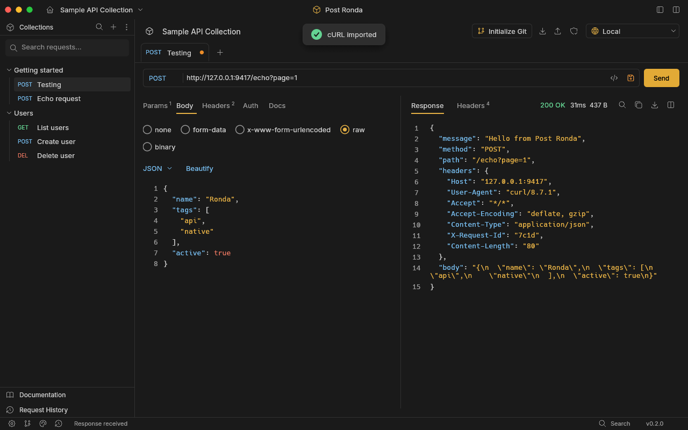

# Post Ronda

A fast, native API client with local-first projects. No account, no cloud sync, no telemetry, no Electron, no webview.

[](https://github.com/ahmadarif-lab/post-ronda/actions/workflows/desktop.yml)

Post Ronda is written in Rust with [egui](https://github.com/emilk/egui). A project is a plain folder on disk, so your collections are easy to read, review and keep in Git.



## Features

**Requests**
- All HTTP methods, query parameters, headers and request documentation.
- Bodies: none, form-data (with file upload), x-www-form-urlencoded, raw (JSON, Text, XML, HTML, JavaScript) and binary file.
- Authorization: API key (header or query parameter), Bearer token and Basic auth.
- Paste a cURL command straight into the URL field to turn it into a request.
- Generate code for the current request in 13 languages (cURL, HTTPie, wget, HTTP, JavaScript, Node.js, Python, PHP, Go, Rust, Ruby, Swift, Java, C#, PowerShell).

**Variables and environments**
- `{{variable}}` in the URL, headers, body and auth. Defined variables are highlighted in blue, missing ones in red.
- In the URL field, hover a variable to see its value and where it comes from, and type `{{` for suggestions.
- Project variables plus switchable environments. Values of secrets (names containing token, key, password…) stay hidden until you ask to see them.

**Responses**
- Status, time and size, syntax-colored JSON, line numbers and line wrapping.
- Find in response, select and copy across any number of lines, save to a file.
- Binary responses are offered as a download instead of being rendered.

**Projects and collaboration**
- Several projects, each in its own folder with `collection.json` and `environments.json`. Switch between them from the title bar.
- Git per project: initialize, set origin, pull and commit & push, using your own Git credentials.
- Folders, drag & drop ordering, pinned items, preview tabs and a request history that survives restarts.
- Cookies are kept between requests (one jar per project).

**Import and export**
- Import Postman collections (v2 and v2.1) and environments, and OpenAPI 3 / Swagger 2 documents (JSON or YAML). Drop files onto the window to import them.
- Export a project or a single folder as a Postman v2.1 collection, or generate Markdown documentation.

**Network**
- Proxy, extra certificate authority and client certificates (mTLS) in *App settings → Network*.
- Per-request timeout, redirect and TLS verification settings.

**Look and feel**
- 8 dark and 6 light themes, configurable font size, side-by-side or stacked layout, and keyboard shortcuts for the common actions.

## Install

Download the package for your system from the [Releases](https://github.com/ahmadarif-lab/post-ronda/releases) page.

| System | Package |
| --- | --- |
| macOS (Apple Silicon) | `Post-Ronda-macos-arm64.zip`, unzip and move *Post Ronda.app* to `/Applications` |
| Linux (x86_64, arm64) | `post-ronda-linux-<arch>.tar.gz`, run `bin/post-ronda` |
| Windows (x64) | `Post-Ronda-windows-x64.zip`, run `PostRonda.exe` |

Post Ronda sends requests through the `curl` command, which ships with macOS and Windows 10+. On Linux install it with your package manager (`curl`). Git is only needed for the Git features.

Release builds are not code-signed yet, so macOS and Windows may warn on first launch. On macOS, right-click the app and choose *Open*.

## Getting started

1. Launch the app. A first project is created for you; use the project switcher in the title bar for *New project…* or *Open project folder…*.
2. Type a URL or paste a cURL command, pick a method and press **Send** (⌘/Ctrl+Enter).
3. Save the request with ⌘/Ctrl+S. Names such as `Auth / Login` place the request in the `Auth` folder; nest as deep as you like.

Single-clicking a request in the sidebar only previews it in an italic tab; edit, send, save or double-click to keep the tab.

## Projects and Git

Each project is a folder:

```
my-api/
├── collection.json      requests, folders and project variables
└── environments.json    environments
```

Both files are plain JSON in Postman v2.1 form with a few extra fields. Nothing is sent anywhere unless you press a Git button.

- **Initialize Git** creates a repository on branch `main`; **Set origin** connects your remote.
- **Commit & Push** stages `collection.json` and `environments.json` only, commits if they changed and pushes `HEAD`. It refuses to run while other files are staged.
- **Pull** runs `git pull --ff-only` and reloads the project. Local changes or conflicts are reported as errors and are never reset.

Request history and cookie jars are kept with the app's own data, not in the project, so they never end up in your repository. Check variables and headers for tokens before sharing a project.

## Keyboard shortcuts

| Action | Shortcut |
| --- | --- |
| Send request | ⌘/Ctrl + Enter |
| New request | ⌘/Ctrl + N |
| Save request | ⌘/Ctrl + S |
| Close tab | ⌘/Ctrl + W |
| Search requests | ⌘/Ctrl + K or P |
| Filter the sidebar (or find in the response when the pointer is over it) | ⌘/Ctrl + F |
| Edit environments | ⌘/Ctrl + E |
| Import cURL | ⌘/Ctrl + I |
| Settings | ⌘/Ctrl + , |

## Settings

The settings button in the status bar offers two sets:

- **App settings**: themes, display, network and keybindings. They apply to every project on the computer.
- **Project settings**: name, documentation, variables, headers, defaults and Git. They belong to the open project.

## Updates

*App settings → About* can look for a newer release when the app starts and on demand. The address is configurable and accepts:

- a GitHub repository, e.g. `https://github.com/ahmadarif-lab/post-ronda` (its latest release is used), or
- any address that returns JSON such as

  ```json
  {
    "version": "1.2.3",
    "url": "https://example.com/Post-Ronda-macos-arm64.zip",
    "notes": "What changed",
    "downloads": { "post-ronda-linux-x86_64.tar.gz": "https://example.com/linux.tar.gz" }
  }
  ```

The download that matches the operating system and CPU is chosen from the file names (`macos`, `linux`, `windows`, `arm64`/`aarch64`, `x86_64`/`x64`). Post Ronda opens the download in your browser; it never installs anything on its own.

## Not included

Pre-request and test scripts, a collection runner, WebSocket, GraphQL-specific tooling and gRPC are out of scope. OAuth 2, Digest and AWS signature authorization are not supported: Postman collections that use them are imported with a note, and the request is left without auth.

## Building from source

You need a recent stable Rust toolchain and `curl`. On Linux also install `pkg-config libx11-dev libxkbcommon-dev libwayland-dev libegl1-mesa-dev libgl1-mesa-dev`.

```sh
cargo run --release                     # start the app
cargo run --release -- /path/to/project # open a project folder
cargo test --locked
cargo clippy --locked --all-targets -- -D warnings
cargo fmt --check
```

Packages:

```sh
./scripts/bundle-macos.sh        # dist/Post Ronda.app (ad-hoc signed)
./scripts/bundle-linux.sh        # dist/post-ronda-linux-<arch>.tar.gz
./scripts/bundle-windows.ps1     # dist/Post-Ronda-windows-x64.zip (PowerShell on Windows)
```

`scripts/Dockerfile.linux` and `scripts/Dockerfile.windows` describe containers for checking Linux builds and cross-compiling Windows builds. `scripts/demo-server.py` is a small local echo server for trying the app offline.

### Releasing

Bump `version` in `Cargo.toml`, then push a tag such as `v0.3.0`. The *Release* workflow builds the packages for every platform and attaches them to a GitHub release, which is where the in-app update check looks.

### Layout

| Path | What it holds |
| --- | --- |
| `src/main.rs` | application state, saving, Git, updates |
| `src/view.rs` | all of the interface |
| `src/style.rs` | themes, icons, syntax colors, preferences |
| `src/http.rs` | request execution through `curl` |
| `src/collection.rs`, `src/collection/openapi.rs` | Postman and OpenAPI import and export |
| `src/curl.rs`, `src/codegen.rs` | cURL parsing and code generation |
| `src/environment.rs` | variables and environments |
| `src/update.rs` | release lookup |
| `assets/` | fonts, icons and the icon atlas that are compiled in |

Generated assets are committed. To rebuild them: `scripts/build-icons.cjs` (icon atlas, needs Node and `sharp`; it downloads the [Tabler](https://tabler.io/icons) icons it needs), `scripts/subset-font.py` (shrinks the full Inter font) and `scripts/make-icns.py` (macOS icon).

## Credits

[Inter](https://rsms.me/inter/) typeface (SIL Open Font License) and [Tabler Icons](https://tabler.io/icons) (MIT). Their licenses are in `assets/`.

## License

[MIT](LICENSE)
